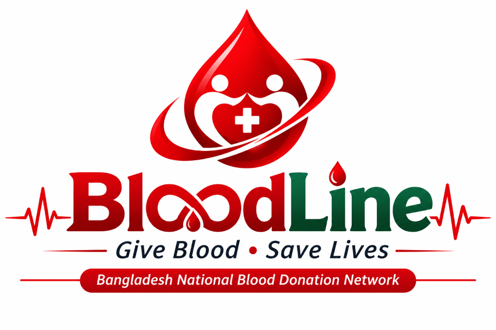

# BloodLine (Bangladesh National Blood Donation & Emergency Response Platform)
> **Give Blood • Save Lives** | Bangladesh National Blood Donation Network



## Overview

**BloodLine** (formerly DonerBond) is a comprehensive, nationwide blood donation, donor discovery, emergency blood request coordination, digital identity verification, hospital & blood bank directory, and volunteer management platform built specifically for the administrative infrastructure of Bangladesh.

---

## 🌟 Key Features

1. **Nationwide Bangladesh Administrative Location Hierarchy**:
   - 8 Divisions, 64 Districts, Upazilas/Thanas, and Union/Ward mapping in both English & Bangla (`বাংলা`).
2. **Privacy-Preserving Donor Discovery Engine**:
   - Double-opt-in contact authorization ensuring donor phone numbers, emails, and exact addresses remain private until explicitly approved.
3. **Emergency Blood Request System**:
   - Urgency triage (Immediate/Critical, Urgent < 12h, Standard < 24h) with real-time broadcast and SMS/email notification dispatcher.
4. **Universal Digital Identity Card System (`BL-` Series)**:
   - Automated issuance of digital donor cards with cryptographically secure QR codes, dynamic flip 3D animation, PDF download, and public verification portal (`/verify`).
5. **Healthcare Transfusion Directories**:
   - Verified hospital and blood bank directories across all 64 districts with blood component inventory tracking.
6. **Volunteer & Campaign Coordination**:
   - Regional volunteer mobilization, donation camp management, and coordinator dashboards.
7. **Role-Based Access Control (RBAC)**:
   - 16 distinct roles ranging from Registered Member to Regional Coordinator, Medical Verification Officer, and Super Administrator.

---

## 🛠️ Technology Stack

- **Frontend**: Next.js 15 (App Router), React 19, TypeScript (Strict), Tailwind CSS, Lucide Icons, React Hook Form, Zod.
- **Backend & Database**: Supabase PostgreSQL (40+ normalized relational tables), Supabase Auth, Row Level Security (RLS) policies.
- **Security & Integrity**: Double-opt-in contact sharing, auditable verification logs, cryptographic token validation.
- **Timezone**: `Asia/Dhaka` (BST / UTC+6).

---

## 🚀 Getting Started

### 1. Prerequisites
- Node.js 18+ or 20+
- Git

### 2. Installation
```bash
# Clone the repository
git clone https://github.com/nusratankhi/bloodline-bd.git
cd bloodline-bd

# Install dependencies
npm install
```

### 3. Environment Variables
Create a `.env.local` file based on `.env.example`:
```env
NEXT_PUBLIC_SUPABASE_URL=https://your-supabase-project.supabase.co
NEXT_PUBLIC_SUPABASE_ANON_KEY=your-supabase-anon-key
SUPABASE_SERVICE_ROLE_KEY=your-supabase-service-role-key
NEXT_PUBLIC_APP_URL=http://localhost:3000
NEXT_PUBLIC_NATIONAL_HOTLINE=10672
NEXT_PUBLIC_SUPPORT_EMAIL=info@bloodline.org
```

### 4. Database Setup
Execute `FULL_DATABASE_SETUP.sql` inside your Supabase Project's SQL Editor to instantiate all 40+ tables, security policies, triggers, and the official Bangladesh 64-district dataset.

### 5. Running the Application
```bash
npm run dev
```
Open [http://localhost:3000](http://localhost:3000) in your browser.

---

## 📜 License
Developed with ❤️ for humanity and the people of Bangladesh.
