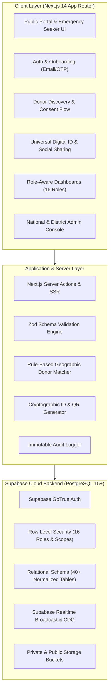

# DonerBond — System Architecture & Engineering Blueprint
## Bangladesh National Blood Donation & Emergency Response Platform

---

## 1. Executive Summary
**DonerBond** is an enterprise-grade, high-availability digital health platform designed to serve as Bangladesh’s national blood donation coordination network. It bridges donors, patients in critical need, volunteers, hospitals, blood banks, and verified coordinators across all 8 Divisions, 64 Districts, Upazilas, Thanas, and Wards.

### Core Value Pillars
- **Zero-Trust Identity**: Role-specific digital IDs with cryptographic QR verification (`DB-DR-2026-XXXXXX`).
- **Privacy-First Matching**: Contact details are protected by an explicit donor consent workflow; no phone numbers or personal records are ever publicly indexed.
- **Medical Integrity**: Clear separation between administrative discovery/coordination and licensed clinical blood testing.
- **Nationwide Scale**: Native support for English and Bangla (`বাংলা`), indexed administrative hierarchy, and low-bandwidth resilience.

---

## 2. Architectural Diagram

---

## 3. Technology Stack Breakdown

| Layer | Technology | Key Responsibility |
|---|---|---|
| **Framework** | Next.js 14 (App Router) | Server components, Server Actions, API routes, streaming SSR |
| **Language** | TypeScript (Strict) | Compile-time type safety across database types and domain schemas |
| **Styling** | Tailwind CSS + shadcn/ui | Design system adhering to DonerBond Red (`#D71920`) & Green (`#006A4E`) |
| **Database** | PostgreSQL on Supabase | ACID transactions, foreign keys, check constraints, indexed geo searches |
| **Security** | Supabase Row Level Security | Enforced data boundary at SQL layer; no client leaks |
| **State & Cache** | TanStack Query v5 | Client-side optimistic updates, cache invalidation, infinite queries |
| **Identity & QR** | QRCode engine + SHA-256 | Cryptographic public token verification (`/verify/id/[token]`) |
| **Timezone** | `Asia/Dhaka` (UTC+6) | Accurate local timestamping for donations and emergency alerts |

---

## 4. Role Hierarchy & Access Matrix

The system models **16 discrete roles**, each with scoped database permissions:

1. `public_visitor` — Read public camps, verified hospital directories, anonymous emergency alerts.
2. `registered_member` — Submit blood requests, apply for roles, access General Member Digital ID.
3. `blood_donor` — Manage availability, set contact consent preferences, view donation history.
4. `blood_seeker` — Post and manage emergency requests, request donor contact approval.
5. `volunteer` — Accept field tasks, assist at camps, track verified volunteer hours.
6. `district_coordinator` — Coordinate regional volunteers and blood requests within district.
7. `upazila_coordinator` — Local sub-district field coordination.
8. `union_coordinator` — Ward and grassroots community coordination.
9. `hospital_admin` — Verify hospital staff, update hospital emergency services.
10. `hospital_staff` — Record verified transfusions and donation receipts.
11. `blood_bank_admin` — Manage blood bank operations and certified inventory updates.
12. `blood_bank_staff` — Process camp blood collection entries.
13. `verification_officer` — Review submitted donor lab documents and medical proofs.
14. `moderator` — Review flagged content, emergency request legitimacy, and user reports.
15. `district_admin` — Administrative governance scoped strictly to assigned district.
16. `super_admin` — Global governance, system settings, card templates, prefix configs, full audit.
